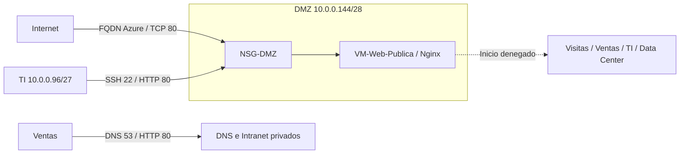

# Informe técnico · CaféNube

## Alcance implementado

El proyecto incorpora una web pública estática para la venta de café de especialidad por suscripción, con los orígenes Huehuetenango, Antigua Guatemala y Cobán. HTML/CSS adaptables se sirven mediante Nginx HTTP TCP 80 en una VM Ubuntu de la DMZ. El sitio no maneja pagos, autenticación ni información personal.

La arquitectura conserva `VNet-CafeNube=10.0.0.0/16` y las redes Visitas `/26`, Ventas `/27`, TI `/27` y Data Center `/28`. La DMZ acordada es `10.0.0.144/28`, con IP propuesta `10.0.0.148`. La IP y el FQDN finales se obtienen de Azure después de desplegar; no se deducen ni inventan.

La política integrada restringe administración a TI, acceso público a TCP 80, servicios privados a empleados autorizados e inicios desde la DMZ hacia redes internas. La regla amplia histórica de Ventas se reduce al servicio DNS. No se publica HTTPS sin TLS.

El hardening compartido configura SSH por clave, UFW, servicios y parámetros de red. cloud-init se genera desde las fuentes de la web y configuración para mantenerlas sincronizadas. El mantenimiento no activa NAT Gateway automáticamente.

## Evidencia y límites

Las pruebas locales se registran en [VALIDACION_LOCAL.md](../evidencias/VALIDACION_LOCAL.md). Las respuestas de CLI simulada corresponden a inventario sintético y no son evidencia de Azure. La [revisión inicial real](../evidencias/REVISION_AZURE_2026-11-17.md) encontró ausentes la DMZ/NSG y detuvo el despliegue.

Durante la integración se consultó ARM desde Cloud Shell y se observó protección de gasto `On` en la suscripción estudiantil. El saldo se conserva de forma privada. Crédito disponible no equivale a tarifa cero; ver [COSTOS_Y_CREDITOS.md](COSTOS_Y_CREDITOS.md).

| Dato que debe completarse con ejecución real | Fuente |
|---|---|
| VM/NIC/subred/IP privadas | Inventario y configuración Azure |
| IPv4 pública y FQDN | `public-endpoint.json` / `endpoint.json` |
| DNS público y HTTP externo | JSON de pruebas y captura con URL/origen |
| cloud-init, Nginx, SSH y UFW | Resultado JSON del guest |
| Reglas efectivas y aislamiento | Decisiones Network Watcher y controles positivos sanos |
| DNS/Intranet privados y resolución de empleados | Pruebas funcionales internas y auditoría de publicación |
| Costo y desasignación | Portal de costos y `PowerState/deallocated` |

El diagrama representa el diseño; contrastarlo con el inventario final. Adjuntar matriz NSG, resultados completos, capturas auténticas y pendientes explícitos. No sustituir resultados faltantes con capturas locales o datos de ejemplo.
