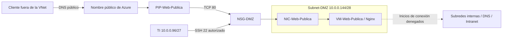

# Entrega de Nina para Diego

**Estado verificable al 17/11/2026:** archivos implementados y comprobados localmente. Se inspeccionó la suscripción real desde Azure Portal y Cloud Shell: faltan `Subnet-DMZ` y `NSG-DMZ`, por lo que el preflight detuvo el despliegue. La creación del servidor público depende de resolver esas piezas con sus responsables y aprobar el costo. Las pruebas del sitio público siguen pendientes.

## Texto que ya se puede incorporar

### Web pública de Ventas y preparación de la DMZ

Se preparó la página pública de CaféNube S.A. tomando como base el HTML inicial proporcionado para el integrante 4. El sitio representa una empresa guatemalteca de café de especialidad por suscripción y presenta los orígenes Huehuetenango, Antigua Guatemala y Cobán. Incluye información de la empresa y de su propuesta de productos, con un diseño adaptable a escritorio y teléfonos. El servicio consiste en contenido estático y no maneja datos personales, pagos ni autenticación.

La publicación prevista utiliza una VM Ubuntu 22.04 independiente de la Intranet y del DNS privado. Su ubicación acordada es `Subnet-DMZ`, bloque `10.0.0.144/28`, dentro de `VNet-CafeNube (10.0.0.0/16)`. Azure reserva cinco direcciones del bloque, por lo que quedan once asignables entre `10.0.0.148` y `10.0.0.158`. Se propone la primera para el servidor público. Esta elección conserva los rangos de Visitas, Ventas, TI y Data Center.

Nginx sirve la página por TCP 80, con listado de directorios deshabilitado, versión oculta y cabeceras de seguridad. La instalación y el hardening del servidor se prepararon mediante cloud-init. El artefacto de inicialización se genera automáticamente a partir del HTML, CSS, configuración Nginx y bootstrap originales; esto evita que una edición de la página deje una copia antigua en la configuración de despliegue.

La IP pública prevista es IPv4 Standard estática, asociada exclusivamente a la NIC del servidor web. El nombre público se obtiene del atributo `dnsSettings.fqdn` de Azure, en vez de suponer un nombre o comprar un dominio. La NIC utiliza explícitamente el resolvedor de Azure para no depender del DNS privado ni abrir excepciones de salida hacia Data Center. No se ha implementado TLS, por lo que esta entrega no publica TCP 443 ni presenta HTTPS como un servicio funcional.

Antes de crear recursos, el preflight comprueba la suscripción, red, asociación del NSG, políticas de entrada/salida, conflictos de IP, propiedad de recursos existentes, disponibilidad del nombre DNS, SKU y cuota de vCPU. La creación necesita una aprobación de presupuesto registrada. Las pruebas preparadas comparan el contenido HTTP real con los archivos entregados, revisan NSGs efectivos y contrastan los intentos desde DMZ con servicios sanos desde TI. Un timeout aislado se registra como inconcluso.

La validación local confirmó la sintaxis Nginx, contenido HTTP, endpoint de salud, cabeceras y comportamiento 404/403. También se comprobó el diseño en anchos de 1440, 390 y 320 píxeles. Estas verificaciones prueban la implementación local y no sustituyen las evidencias del escenario en Azure.

### Verificación real previa al despliegue

La revisión de la suscripción confirmó `VNet-CafeNube (10.0.0.0/16)` en `northcentralus`, con las cuatro subredes originales y sus NSGs. No existe todavía la DMZ propuesta. El preflight registró `ResourceNotFound` al consultar `NSG-DMZ`; la consulta de `10.0.0.148` devolvió `PrivateIPAddressNotInAnySubnet`. Este último resultado no demuestra una IP disponible: falta incorporar su subred y volver a comprobarla.

Las únicas VMs del grupo son `VM-Ventas-1` y `VM-Ventas-2`, ambas desasignadas y sin IP pública. No aparecen `VM-Web-Publica`, `NIC-Web-Publica`, `PIP-Web-Publica`, `VM-DNS` ni `VM-Intranet` en el inventario del grupo. También existe `VNet-CafeNube-bastion`, cuyo SKU consultado es `Developer`; el diagrama final debe reflejar el estado real. No se modificó ese recurso.

El inventario y los fallos se conservaron en registros reales de Cloud Shell. [REVISION_AZURE_2026-11-17.md](../evidencias/REVISION_AZURE_2026-11-17.md) resume los comandos y conclusiones. La comprobación previa sigue detenida; no hubo despliegue ni pruebas exitosas de publicación pública.

## Datos por completar únicamente después del despliegue

| Campo | Estado actual | Fuente real requerida |
|---|---|---|
| VM/NIC y ubicación real | Pendiente | Inventario Azure y captura de la NIC en DMZ |
| IP privada real | Pendiente; propuesta `10.0.0.148` | Configuración de la NIC |
| IPv4 pública y FQDN | Sin asignación comprobada | `public-endpoint.json` / `endpoint.json` |
| Resolución pública | Pendiente | Resolvedor local, `1.1.1.1`, `8.8.8.8` |
| HTTP desde Internet | Pendiente | Resultado 200, SHA256 y captura externa con URL |
| Nginx/cloud-init/UFW/SSH en Ubuntu | Pendiente | `guest-services-parsed.json` |
| Aislamiento DMZ | Pendiente | `flow-*.json`, pruebas guest y controles sanos desde TI |
| Intranet y DNS privados sin publicación | Pendiente | NICs, frontends/NAT/proxies y pruebas de Adrián/José |
| Costo real / crédito / apagado | Pendiente | Portal de costos y estado `PowerState/deallocated` |
| TLS | No implementado | No reclamar puntos extra |

El FQDN real puede variar por las reglas de unicidad de Azure. Copiarlo de la salida del recurso. Nunca reemplazar estos campos con ejemplos.

## Diagrama parcial para integrar al diagrama del grupo

Diagrama previsto, pendiente de contrastar con Azure. La flecha discontinua representa una prohibición, no un flujo permitido. Diego debe integrarlo al diagrama final del equipo junto con las reglas verificadas.

## Fila para la tabla Word de aportes

| Integrante | Servicios y configuraciones implementados | Estado | Tiempo |
|---|---|---|---|
| Nina Nájera, 231088 | Página pública HTML/CSS; configuración Nginx HTTP 80; generador cloud-init y hardening de la VM; scripts de preflight/despliegue/DNS/desasignación; pruebas de seguridad e idempotencia; procedimiento y sección de reporte | Implementación local validada; despliegue y evidencias Azure pendientes | Estimación de planificación: 4–6 h. Completar horas reales de Nina después de integración |

La estimación no representa horas reales medidas ni un despliegue ya ejecutado. Las reglas NSG y la creación de la subred deben figurar como aportes de sus respectivos responsables.

## Paquete para entregar

- Carpeta `integrante4/` de la rama publicada, con scripts, fuentes y configuración.
- Este texto, la fila de aportes y [SEGURIDAD_CON_JOSE.md](SEGURIDAD_CON_JOSE.md) para integrar decisiones y correcciones del informe.
- [VALIDACION_LOCAL.md](../evidencias/VALIDACION_LOCAL.md), como evidencia local claramente rotulada.
- Después de Azure: `RESULTADOS.md`, JSON seleccionados, FQDN/IP reales, capturas externas y captura de desasignación. Revisar que no contengan credenciales.
- Actualizar todas las tablas del informe con resultados reales, responsable y fecha. Los pendientes no se marcan como aprobados.
